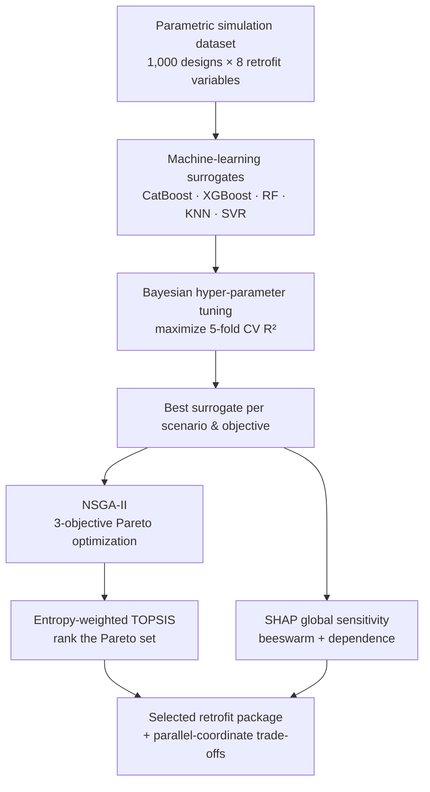
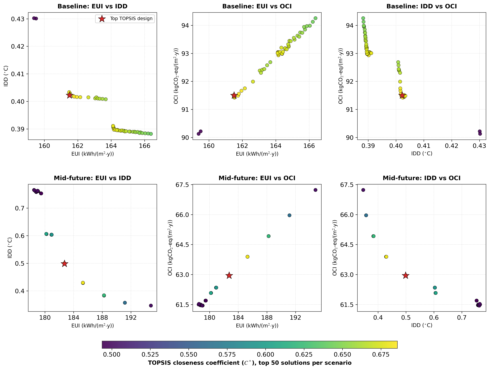
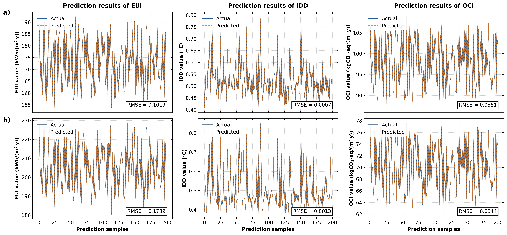
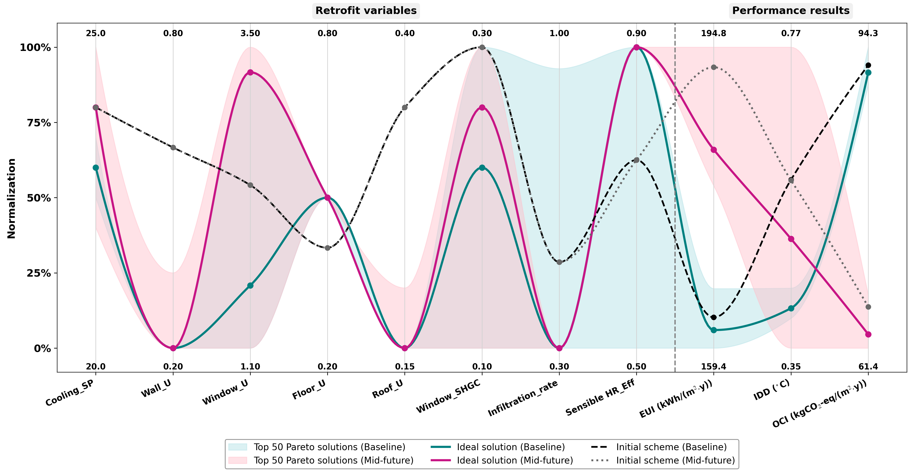
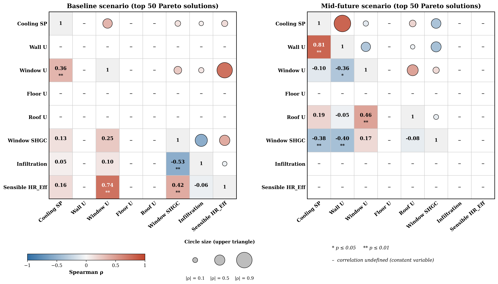
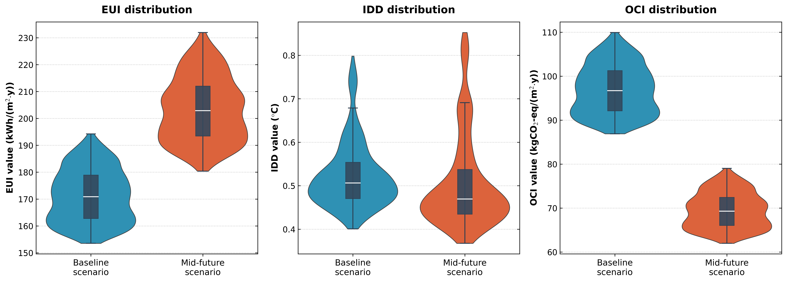

# Data-Driven Multi-Objective Optimization of Building Energy, Indoor Discomfort & CO₂ Emissions

### Under future climate change and grid decarbonization

[](LICENSE)
[](https://www.python.org/)
[](https://pymoo.org/)
[](https://shap.readthedocs.io/)

This repository is the reproducible research code, data, and result artifacts for the
paper **“A data-driven multi-objective optimization of building energy consumption,
indoor discomfort, and CO₂ emissions under future climate change and grid
decarbonization.”**

It turns a 1,000-design parametric simulation study into *actionable retrofit
packages* by coupling **machine-learning surrogates**, **SHAP sensitivity analysis**,
and **NSGA-II multi-objective optimization with entropy-weighted TOPSIS ranking** —
evaluated under both a **Baseline** and a **Mid-future (2050)** climate /
grid-decarbonization scenario.

---

## Highlights

- **Three competing objectives** optimized jointly: energy use intensity (**EUI**),
  indoor discomfort degree (**IDD**), and operational carbon intensity (**OCI**).
- **Five surrogate models** (CatBoost, XGBoost, Random Forest, KNN, SVR) tuned by
  Bayesian optimization — the best CatBoost surrogates reach **test R² ≥ 0.9998** with
  **CV-RMSE ≤ 0.27 %** across every objective and scenario.
- **NSGA-II Pareto fronts** ranked with an entropy-weighted **TOPSIS** proximity
  coefficient to select a single best-compromise design per scenario.
- **Explainable results** — SHAP beeswarm/dependence plots identify the dominant
  retrofit levers (cooling set-point, infiltration, envelope U-values).
- Fully **reproducible**: one seed, one config, one command regenerates every figure
  and table in the paper.

### Selected results (from the committed run)

| Scenario | Cooling_SP | Wall_U | Window_U | Floor_U | Roof_U | SHGC | Infiltration | HR_Eff | EUI | IDD | OCI |
|---|---|---|---|---|---|---|---|---|---|---|---|
| **Baseline** | 23.0 | 0.20 | 1.6 | 0.5 | 0.15 | 0.22 | 0.30 | 0.90 | 161.51 | 0.402 | 91.50 |
| **Mid-future** | 24.0 | 0.20 | 3.3 | 0.5 | 0.15 | 0.26 | 0.30 | 0.90 | 182.73 | 0.499 | 62.95 |

Best-compromise (highest TOPSIS `C*`) design per scenario. Relative to the mean of the
sampled designs:

- **Baseline**: EUI **−5.7 %**, IDD **−23.1 %**, OCI **−5.6 %**.
- **Mid-future**: EUI **−10.1 %**, IDD **−1.3 %**, OCI **−9.4 %**.

The objectives are strongly coupled: **EUI–OCI** are near-perfectly positively
correlated (Pearson r ≈ 0.998–0.999), while **EUI–IDD** trade off sharply
(r ≈ −0.903 Baseline, −0.915 Mid-future) — i.e. comfort improvements generally cost
energy, so the Pareto set is a genuine trade-off surface.

---

## Method



The decision variables are constrained to the discrete levels that actually appear in
the simulation dataset, so every reported optimum is a **physically realisable retrofit
package** rather than an interpolated point.

---

## Repository structure

```
building-retrofit-moo-climate/
├── pipeline_full_colab.py        # ★ The ORIGINAL end-to-end script, verbatim
├── data/                         # Input simulation datasets (one per scenario)
│   ├── Base_Scenario_with_OCE.csv
│   └── 2050_Scenario_with_OCE.csv
├── src/building_retrofit_moo/    # Installable analysis package
│   ├── config.py                 # Seeds, budgets, labels, palettes, paths
│   ├── data.py                   # Loading / cleaning / scenario detection
│   ├── models.py                 # Surrogate zoo + Bayesian tuning
│   ├── sensitivity.py            # SHAP values + correlation statistics
│   ├── optimization.py           # NSGA-II + entropy weights + TOPSIS
│   ├── figures.py                # Every publication figure
│   ├── pipeline.py               # End-to-end orchestration
│   ├── io_utils.py               # Long-path-safe file helpers
│   └── cli.py                    # `building-retrofit-moo` entry point
├── scripts/
│   ├── run_pipeline.py           # Thin wrapper: run the package without installing
│   └── verify_environment.py     # Dependency / data sanity check
├── notebooks/
│   ├── pipeline_full_colab.ipynb # ★ The original script, runnable in Colab
│   └── 00_quickstart_colab.ipynb # Colab front-end for the refactored package
├── results/
│   ├── figures/                  # PNG (raster) + PDF (vector) figures
│   └── tables/                   # All result tables (CSV)
├── docs/                         # Data dictionary & methods notes
├── requirements.txt
├── pyproject.toml
├── CITATION.cff
└── LICENSE
```

### Which file is which?

The original study was one long Google Colab script. Both the original and the
refactored form are kept **in full**, so nothing about the work is hidden behind
an abstraction:

| File | What it is | How to run it |
|---|---|---|
| [`pipeline_full_colab.py`](pipeline_full_colab.py) | **The original end-to-end script, byte-for-byte unchanged** (1,410 lines, SHA-256 `083eb764…`). This is the authoritative record of the work. | Not directly — it is a Colab export containing `!pip install` lines, which is invalid Python outside a notebook. Open the notebook below instead. |
| [`notebooks/pipeline_full_colab.ipynb`](notebooks/pipeline_full_colab.ipynb) | The same script as a **runnable Colab notebook**. Every code line is identical; only the lost cell boundaries were rebuilt from the `CELL n` markers. | Upload it to [Colab](https://colab.research.google.com/) and run all cells. |
| [`scripts/run_pipeline.py`](scripts/run_pipeline.py) | A thin wrapper around the refactored package (~20 lines *by design*) — it just puts `src/` on the path and calls the real pipeline, which lives in `src/building_retrofit_moo/`. | `python scripts/run_pipeline.py` |
| [`src/building_retrofit_moo/`](src/building_retrofit_moo) | The refactored implementation (~1,670 lines across 10 modules) — this is where the pipeline logic and all figures actually live. | `pip install -e .` then `building-retrofit-moo` |

> The original script is a Colab notebook export, so it reads its two CSVs through
> `google.colab.files.upload()`. The refactored package reads the committed files in
> `data/` instead, which is why it can run headless and in CI.

---

## Data

Each CSV contains the **same 1,000 sampled designs** evaluated under one scenario.
Columns:

| Variable | Meaning |
|---|---|
| `Cooling_SP` | Cooling set-point (°C) |
| `Wall_U` | Wall U-value (W/m²K) |
| `Window_U` | Window U-value (W/m²K) |
| `Floor_U` | Floor U-value (W/m²K) |
| `Roof_U` | Roof U-value (W/m²K) |
| `Window_SHGC` | Window solar heat-gain coefficient |
| `Infiltration_rate` | Air infiltration rate (h⁻¹) |
| `Sensible HR_Eff` | Sensible heat-recovery efficiency |
| `EUI` | Energy use intensity (kWh/m²·y) |
| `IDD` | Indoor discomfort degree (°C) |
| `OCI` | Operational carbon intensity (kgCO₂-eq/m²·y) |

> The `Baseline` and `Mid-future` files are *paired*: the pipeline asserts the input
> design matrices are identical before proceeding.

---

## Installation

```bash
git clone https://github.com/Alirezza18/building-retrofit-moo-climate.git
cd building-retrofit-moo-climate

python -m venv .venv
# Windows: .venv\Scripts\activate   |   macOS/Linux: source .venv/bin/activate
pip install -r requirements.txt

# optional: install the package itself (enables the `building-retrofit-moo` command)
pip install -e .

# confirm everything is available
python scripts/verify_environment.py
```

Requires **Python ≥ 3.10** (tested on 3.10–3.14).

---

## Usage

### Fast smoke test

```bash
python scripts/run_pipeline.py --quick
```

### Full paper-grade run

```bash
python scripts/run_pipeline.py            # or: building-retrofit-moo
```

### From Python

```python
from building_retrofit_moo import run_pipeline, quick_settings, Settings

results = run_pipeline(settings=quick_settings())   # or Settings() for the full run

results["selected"]                 # best-compromise design per scenario
results["optimal_vs_reference"]     # % change vs the mean sampled design
results["pareto"]["Baseline"]       # the ranked Pareto set
```

### In Google Colab

Open [`notebooks/00_quickstart_colab.ipynb`](notebooks/00_quickstart_colab.ipynb) —
it installs dependencies, locates the repo, runs the pipeline, and displays the
resulting figures and tables inline.

All outputs are written to `results/figures/` and `results/tables/`.

---

## Results gallery

**Pareto fronts with the TOPSIS-selected design (top 50 solutions per scenario)**



**SHAP global sensitivity (beeswarm + mean |SHAP| bars)**


**Actual vs. predicted objective values (CatBoost surrogates)**



**Parallel-coordinate trade-offs: retrofit variables → performance outcomes**



**Spearman correlation structure of the Pareto set**



**Objective distributions over the whole dataset**



---

## Outputs reference

### Figures (`results/figures/`)

| Figure | File |
|---|---|
| Fig. 4 — model comparison (5 models × 3 objectives) | `Figure4_model_comparison_{Baseline,Mid_future}.png/.pdf` |
| Fig. 5 — actual vs. predicted | `Figure_5_Actual_vs_Predicted.png/.pdf` |
| Fig. 6 — performance metrics comparison | `Figure_6_Performance_Metrics_Comparison.png/.pdf` |
| Fig. 8 — SHAP dependence | `Figure_8_SHAP_Dependence_{Baseline,Mid_future}.png` |
| Fig. 9 — objective distributions | `Figure_9_Violin_Distributions_All_Data.png/.pdf` |
| Fig. 10 — parallel coordinates | `Figure_10_Parallel_Coordinates_top50.png` |
| Fig. 11 — correlation heatmaps | `Figure11_{Spearman,Pearson}_heatmap_top50.png` |
| Pareto fronts | `Pareto_fronts_top50.png` |
| SHAP summary | `SHAP_summary_figure.png/.pdf` |

### Tables (`results/tables/`)

`model_comparison_*.csv`, `Table_A1_all_models.csv`, `final_model_performance.csv`,
`pareto_solutions_*.csv`, `selected_TOPSIS_designs.csv`, `optimal_vs_reference.csv`,
`Table3_Pairwise_Relationships.csv`, `Figure_10_data_inputs_outputs.csv`,
`Figure_10_axis_bounds.csv`, `spearman_*` / `pearson_*` correlation tables.

---

## Reproducibility

- A single global `SEED = 42` controls the train/test split, the K-fold CV, the
  Bayesian optimizer and NSGA-II — results are deterministic.
- All hyper-parameters, budget sizes and figure settings live in
  [`src/building_retrofit_moo/config.py`](src/building_retrofit_moo/config.py).
- The committed `results/` artifacts were generated by the original Colab run; rerun
  the pipeline to regenerate them from scratch.

### Troubleshooting

**Windows `FileNotFoundError` / `[Errno 2]` on `results/...`** — very long repository
paths can exceed Windows' 260-character `MAX_PATH` limit. This code is already
long-path-safe via `io_utils.fs_path`, but if you still hit issues, enable long paths
(`LongPathsEnabled`) or clone into a shorter directory such as `C:\repos\`.

---

## Citation

If you use this code or data, please cite the paper and this repository — see
[`CITATION.cff`](CITATION.cff).

```bibtex
@software{alireza2026buildingretrofit,
  title   = {Data-Driven Multi-Objective Optimization of Building Energy Consumption,
             Indoor Discomfort, and CO2 Emissions under Future Climate Change and
             Grid Decarbonization},
  author  = {Ali Reza},
  year    = {2026},
  version = {1.0.0},
  license = {MIT}
}
```

---

## License

Released under the [MIT License](LICENSE). Please also respect any terms attached to
the underlying simulation dataset and the published paper.
